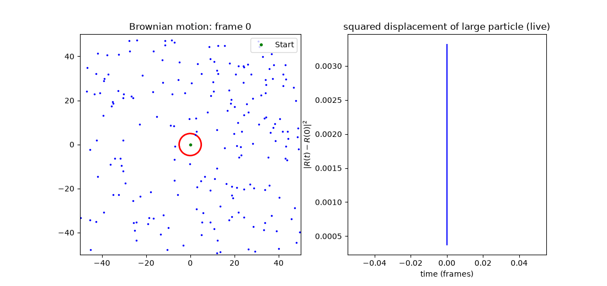
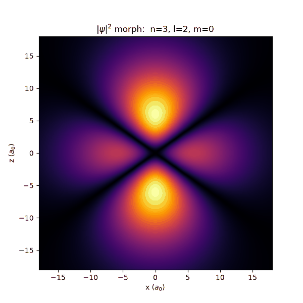

# Quantum Mechanics Lab — BPhO Computational Challenge 2026

Ten computational physics models covering the quantum revolution, written in
Python, each built with a **quantitative check that could prove it wrong**.
Everything launches from one app.



*Task 2: a large particle, programmed with zero initial motion, acquires a
random walk purely from momentum-conserving collisions with 200 gas molecules.*

---

## What's here

| # | Model | The check that proves it right |
|---|-------|-------------------------------|
| 1 | Random walk | RMS displacement matches s√N over 4,000 walks; 5,000-walk histogram fits the Rayleigh distribution to ~1% |
| 2 | Brownian motion | Mean squared displacement grows linearly with time — Einstein's 1905 diffusion law |
| 3 | Planck's law + Einstein heat capacity | Wien's law locus passes through every spectral peak; curves approach the Dulong–Petit limit from below |
| 4 | Photoelectric effect | Planck's constant recovered from *simulated noisy data* by least squares, to 0.06% |
| 5 | Hydrogen spectrum | Balmer lines match laboratory values to <0.04% — and to 0.001% once reduced mass and air/vacuum are accounted for |
| 6 | Electron diffraction | 1/√V vs sin θ is linear through the origin; both graphite spacings recovered from the fitted gradients |
| 7 | Particle in a box | Δx·Δp/ħ = 0.5679 at n=1 by numerical integration (exact analytic value 0.5678); every state obeys Heisenberg 
| 8 | Quantum cryptography | Aligned detectors give exactly zero quantum mismatch — the entanglement signature no classical model reproduces |
| 9 | Compton scattering | At 511 keV, maximum shift is exactly 2.0000 and recoil speed exactly 0.800c; energy conservation closes to machine precision |
| 10 | Hydrogenic orbitals | All orbitals normalise to 1.000000; ⟨r⟩ matches (a₀/2)[3n²−l(l+1)]; the 1s peak lands at the Bohr radius |

### Extensions beyond the brief

- **PhET-style photoelectric simulator** — drawn apparatus, animated photons and
  electrons, and a retarding-voltage slider you can take a real measurement
  from: raise it and the current dies at exactly the predicted stopping voltage.
- **LCAO molecular orbitals** — combining two hydrogen 1s wavefunctions produces
  bonding and antibonding states for H₂⁺, with a bond-length slider. A covalent
  bond, emerging from the Schrödinger equation.
- **Orbital morphing** — animated transitions between m states for n=3, l=2.
- **CIE 1931 colour engine** — spectra converted to screen colours through real
  colour-matching functions with gamma correction, so the hydrogen spectrum and
  black-body glow colours are *computed*, not chosen.
- **Einstein diffusion study** — 30 runs × 2,000 steps, headless, measuring MSD.



*Task 10 extension: |ψ|² morphing between magnetic quantum number states.*

---

## Running it

```bash
pip install numpy matplotlib
python quantum_lab.py
```

`quantum_lab.py` is a dark-themed launcher that opens each module as a separate
process. Or run any task directly:

```bash
python task7_particle_in_box.py
```

Requirements: Python 3.8+, numpy, matplotlib. No other dependencies — the
special functions (associated Laguerre and Legendre polynomials) are implemented
from their recurrence relations rather than imported.

---

## Repository layout

```
task1_random_walk.py              Tasks 1-10, one file each
task2_brownian_motion.py
task2_extension_diffusion.py      MSD measurement run (no animation — 100x faster)
task4_app_photoelectric.py        the virtual lab
task10_extension_morph.py         m-state morphing animation
task10_extension_molecules.py     LCAO molecular orbitals
cie_color.py                      CIE 1931 colour engine, shared by tasks 3/4/5
quantum_lab.py                    the launcher
study_copies/                     annotated versions of the code
QM_Course/                        a 22-chapter course teaching all of the above
video_script.md                   script for the 3-minute submission screencast
```

### QM_Course

A complete offline course written alongside the project: 22 chapters from
`print("hello")` through numpy, every physics model derived and rebuilt line by
line, to a capstone that has you reconstruct the whole entry from an empty
folder. Includes six reference sheets and runnable solution files.

Open `QM_Course/site/index.html` in any browser — no internet required.

---

## Notes on method

Every model separates **simulation from measurement**. The animated Brownian
demo and the 30-run diffusion study are different files, because drawing is
roughly 100× slower than arithmetic and the two have different jobs.

Where a result could be checked, it is: against an analytic limit, against
laboratory data, or by running the physics backwards (fitting a line, then
inverting the gradient to recover the atomic spacing that was put in).

Simplifying assumptions are stated rather than hidden — the Brownian model
ignores molecule–molecule collisions, treats collisions as impulses along the
line of centres, and uses a constant drag factor rather than deriving Stokes
drag. Each is defensible for the phenomenon being demonstrated, and each is a
ready-made extension.

---

## Challenge materials

The challenge pack and quantum mechanics problem sheets are copyright the
British Physics Olympiad and Dr A. French, and are **not** redistributed here.
They are freely available from:

- [BPhO Computational Challenge](https://www.bpho.org.uk/bpho/computational-challenge/)
- [Dr French's resource site](https://eclecticon.info/physics_bpho_compphys.htm)

## Licence

[MIT](LICENSE) — my code. The physics belongs to Planck, Einstein, Bohr,
de Broglie, Compton, Schrödinger and Heisenberg, who did the hard part.

---

Built for the BPhO Computational Challenge 2026 by [@hacport](https://github.com/hacport).
